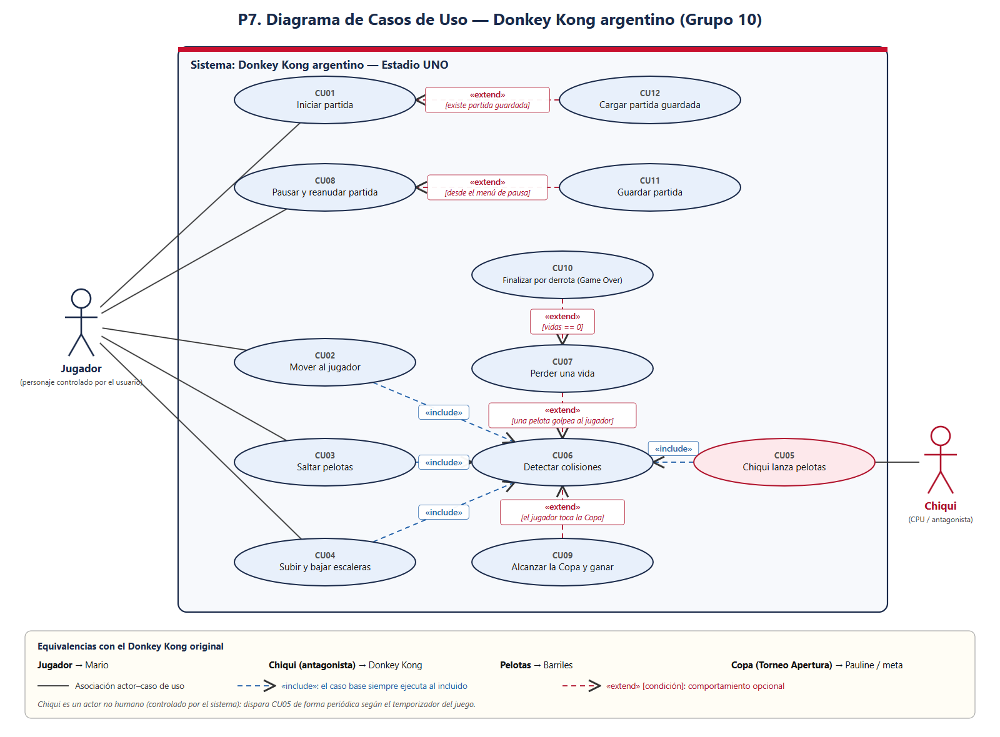

# Chiqui League

Donkey Kong argentinizado · Processing / Java · Algoritmos 1 — TPI 2026

---

## Descripción

Versión simplificada del clásico arcade Donkey Kong, ambientada en el Estadio UNO de Estudiantes de La Plata.

Controlás a **La Bruja**, que arranca abajo a la izquierda. Arriba está **Chiqui**, que lanza pelotas cada 2,2 segundos, y en la esquina superior derecha espera **la Copa**.

**Objetivo:** subir los 5 pisos por las escaleras, esquivar o saltar las pelotas y llegar a la Copa antes de que se acabe el bonus.

> En pantalla el juego está argentinizado, pero las clases mantienen los nombres originales: La Bruja = `Mario`, Chiqui = `DonkeyKong`, la Copa = `Pauline`, pelotas = `Barril`.

---

## Controles

| Estado | Teclas |
|---|---|
| Menú | `ESPACIO` / `ENTER` → nueva partida · `C` → cargar partida |
| Jugando | `A` / `D` mover · `W` / `S` escaleras · `ESPACIO` saltar · `P` pausa · `G` guardar · `ESC` menú |
| Pausado | `P` continuar · `ESC` menú |
| Golpeado | (dura 3 s) · `ESC` menú |
| Campeones / Descendido | `R` / `ENTER` nueva partida · `ESC` menú |

---

## Mecánicas principales

- **Movimiento:** 220 px/s. El sprite se espeja al mirar a la izquierda.
- **Salto:** solo si está en el suelo y no en escalera. Velocidad inicial `-420`, gravedad `1400`.
- **Escaleras:** `W`/`S` a 160 px/s, sin gravedad, sin colisión con plataformas. No puede bajar más allá del pie.
- **Pelotas:** ruedan a 180 px/s, caen al borde (gravedad 1200), rebotan en paredes y se eliminan al salir.
- **Golpe:** si una pelota toca a La Bruja, el juego se congela 3 s (sprite golpeado + Chiqui riéndose) y recién ahí se pierde la vida. Si se cae de la pantalla, la pierde en el momento.
- **Puntaje:** +100 por piso nuevo (una vez), +100 por pelota saltada (una vez), +1000 + bonus al ganar.
- **Bonus:** arranca en 5000, baja 100 cada 2 s. Uno solo por partida. Si llega a 0 → derrota.
- **Vidas:** 3. Sin vidas o sin bonus → **DESCENDIDO**.

---

## Arquitectura

Separación tipo **MVC** con **patrón State**:

```
Game.pde (sketch)
  ├── GameController  → lógica, estados, teclas, puntaje/bonus
  ├── GameView        → dibujo, sprites, fondo animado, HUD
  └── Modelo          → Partida → Nivel → Mario, DK, Pauline, Barril, Plataforma, Escalera
```

- **Patrón State:** `GameState` (interfaz) + 6 estados → `MenuState`, `PlayingState`, `PausedState`, `GolpeadoState`, `VictoryState`, `GameOverState`. El controlador delega en el estado actual (`estado.update(this, dt)`).
- **Interfaces:** `Colisionable` (AABB), `Movible` (contrato de movimiento), `GameState`.
- **Persistencia:** `SaveManager` → `partida.txt` (6 líneas: vidas, puntaje, x, y, bonus, piso récord). Compatible con guardados viejos de 4 líneas.
- **Excepciones:** `GameException` ← `SaveGameException`, `LoadGameException`.

**Entrada del juego:** `Game.pde` es el único con `setup()` y `draw()`. No hay `main`: Processing lo genera.

---

## Documentación

### Diagrama de Casos de Uso


| Recurso | Ubicación |
|---|---|
| Diagramas de secuencia (CU01–CU12) | `docs/diagramas/secuencia/` |
| Diagramas UML (clases, estados) | `docs/diagramas/` |
| Sprites y fondos | `data/` (19 imágenes) · respaldo en `data/antiguo/` |

**Flujo de un frame:**
```
Game.draw()
  → dt = (millis() - lastTime)/1000 (tope 0,05 s)
  → controller.update(dt)  → estado.update(this, dt)   [polimorfismo]
  → view.render(controller) → según getNombreEstado()
```

---

**Grupo 10** — Algoritmos 1, TPI 2026, 2.º cuatrimestre. 
**Integrantes:**
- Alejo Trenti
- Gonzalo Bolognese
- Valentín Valle

Repo: `alejotrenti/donkey-kong`.
